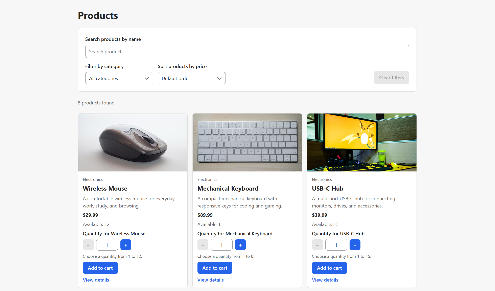
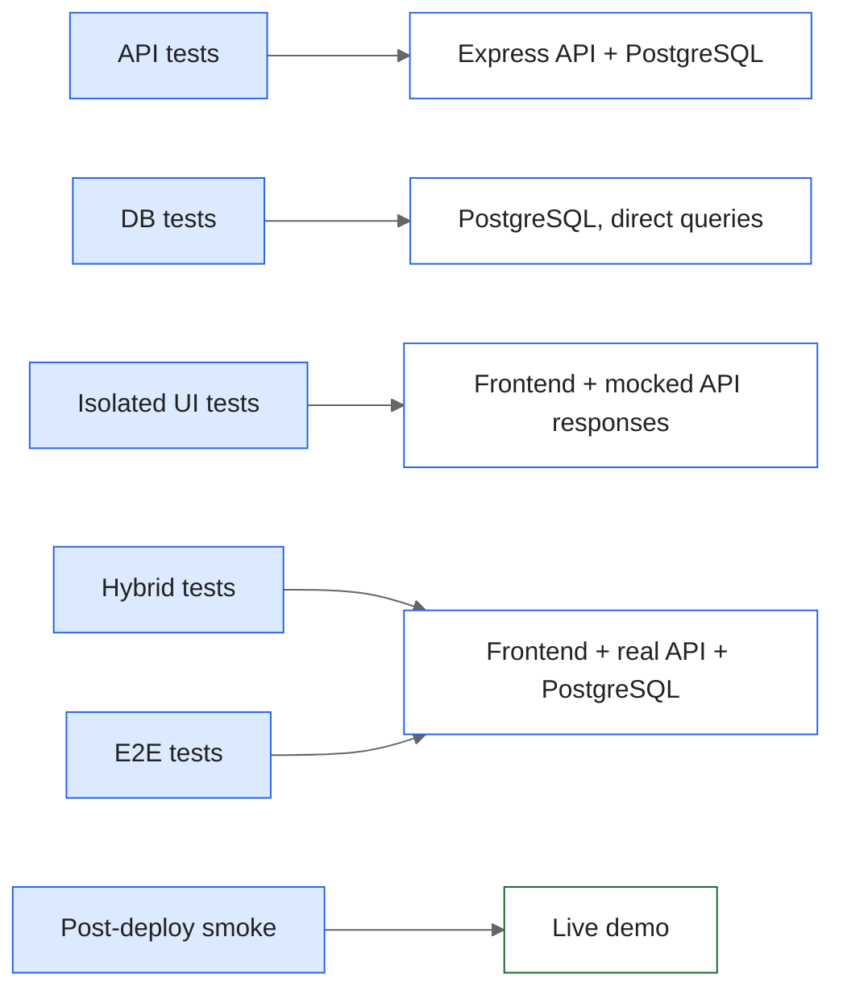

# NovaShop

[](https://github.com/alitsman/novashop/actions/workflows/ci.yml)
[](https://github.com/alitsman/novashop/actions/workflows/nightly.yml)
[](https://github.com/alitsman/novashop/actions/workflows/deploy-demo.yml)

A test automation portfolio project. NovaShop is a full-stack web shop built as a realistic test target, and the focus of the repository is its automation: 400+ Playwright and TypeScript tests across API, database and browser layers, a risk-based test strategy, CI with a merge gate, cross-browser nightly regression, and automated deployment with post-deploy smoke tests.

**Explore:** [Live demo](https://novashop-demo.pages.dev) · [Nightly Playwright report](https://alitsman.github.io/novashop/) · [Test Automation Strategy](docs/test-strategy.md) · [Demo deployment](docs/deployment.md)

To try the demo, create an account using fictional details. If you place an order, use fictional contact and delivery information as well. The backend runs on a free hosting plan, so the first request after inactivity may be slow.



## Highlights

- **Risk-based test layers.** API, DB, Isolated UI, Hybrid and E2E tests have separate responsibilities. Each risk has one main owner layer, so the same check is not repeated across layers without a reason.
- **Isolated UI without a backend.** Frontend states are tested with mocked responses, and any API request without a mock fails the test. Mock helpers validate responses with the same runtime schemas that check the real API.
- **Real integration where it matters.** Critical journeys run through the real stack. A DB test proves that two orders for the last item cannot oversell, and pending states are tested by holding real requests instead of waiting for time.
- **Controlled test data.** Tests run only against a guarded test database, the seed data is read-only, and every test that changes data creates its own.
- **CI/CD with quality gates.** Pull requests must pass the regression gate without retries. Nightly regression runs in Chromium, Firefox and WebKit in about 5–6 minutes (down from 14–22 minutes after moving browser jobs to the official Playwright container) and publishes its report. Each demo deployment is verified by commit SHA on both the backend and the frontend before read-only smoke tests run.
- **Accessibility.** Automated WCAG 2.1 A/AA scans with axe-core on every page and key state, plus functional checks of focus, labels and keyboard behavior.

## Test architecture



| Layer             | What it proves                                                                              |
| ----------------- | ------------------------------------------------------------------------------------------- |
| API               | HTTP contract, server validation, authentication, authorization, ownership, business errors |
| DB                | effects an HTTP response cannot prove: soft delete, password hashing, concurrent orders     |
| Isolated UI       | frontend behavior: rendering, validation, focus, loading, empty and error states, routing   |
| Hybrid            | frontend behavior with a real user and real server state, prepared through the API          |
| E2E               | a few critical journeys through the full stack                                              |
| Post-deploy smoke | the deployed demo works after each deployment                                               |

### Coverage by feature

| Feature                                    | API | DB  | Isolated UI | Hybrid | E2E | Accessibility scans |
| ------------------------------------------ | :-: | :-: | :---------: | :----: | :-: | :-----------------: |
| Authentication                             |  ✓  |  ✓  |      ✓      |   ✓    |  ✓  |          ✓          |
| Application shell                          |     |     |      ✓      |        |     |          ✓          |
| Catalog                                    |  ✓  |  ✓  |      ✓      |   ✓    |     |          ✓          |
| Product details                            |  ✓  |     |      ✓      |   ✓    |     |          ✓          |
| Add to cart                                |     |     |      ✓      |        |  ✓  |                     |
| Cart                                       |     |     |      ✓      |   ✓    |  ✓  |          ✓          |
| Checkout                                   |  ✓  |  ✓  |      ✓      |        |  ✓  |          ✓          |
| Order history                              |  ✓  |     |      ✓      |        |  ✓  |          ✓          |
| Admin products                             |  ✓  |     |      ✓      |        |  ✓  |          ✓          |
| Platform (health, routing, request errors) |  ✓  |     |             |        |     |                     |

✓ means that the layer has targeted tests for this feature, not that every scenario is covered there. An empty cell is a decision: the risk is owned by another layer. The reasons are in the [Test Automation Strategy](docs/test-strategy.md).

## CI/CD

| Workflow                | When                                  | What runs                                                                           |
| ----------------------- | ------------------------------------- | ----------------------------------------------------------------------------------- |
| CI                      | every pull request and push to `main` | quality checks, all test layers in Chromium, Docker verification; required to merge |
| Nightly Full Regression | daily                                 | all tests in Chromium, Firefox and WebKit; report published to GitHub Pages         |
| Manual Full Regression  | manual                                | all tests in Chromium, Firefox and WebKit                                           |
| Smoke, Manual Targeted  | manual                                | selected tests, features and browsers                                               |
| Deploy Demo             | after green CI on `main`              | deployment, version checks, post-deploy smoke                                       |

## Tech stack

- **Automation:** Playwright, TypeScript, zod, axe-core
- **Frontend:** React, TypeScript, Redux Toolkit, React Router, Vite
- **Backend:** Express, TypeScript, PostgreSQL, JWT
- **Infrastructure:** Docker Compose, GitHub Actions, Render, Neon, Cloudflare Pages, GitHub Pages

## Run locally

### Run the application with Docker

You need only Docker Desktop (or Docker Engine with Compose). Node.js and PostgreSQL are not required. The Docker setup uses multi-architecture base images and should work on Windows, macOS (Intel and Apple Silicon) and Linux. It has been run on Windows and in CI on Linux, but not on macOS.

1. Clone the repository:

   ```bash
   git clone https://github.com/alitsman/novashop.git
   cd novashop
   ```

   Copy `.env.example` in the repository root to `.env`. Do not commit `.env`.

2. Fill in the values in `.env`:
   - `POSTGRES_PASSWORD` and `JWT_SECRET` are required. Use random hexadecimal values; other characters can break the database connection URL.
   - `ADMIN_PASSWORD` is needed only for the seed step below. It must be at least 16 characters long.

   To generate a random hexadecimal value:

   ```bash
   # Git Bash, WSL, Linux or macOS
   openssl rand -hex 32
   ```

   ```powershell
   # Windows PowerShell 5.1 or PowerShell 7
   $bytes = New-Object byte[] 32; [Security.Cryptography.RandomNumberGenerator]::Create().GetBytes($bytes); ($bytes | ForEach-Object { $_.ToString("x2") }) -join ""
   ```

3. Build and start the application:

   ```bash
   docker compose up -d --build --wait backend frontend
   ```

   This starts PostgreSQL, runs the database migrations, and then starts the backend and the frontend.

4. Open http://localhost:8080. Use `localhost`, not `127.0.0.1`: the backend accepts requests only from `http://localhost:8080`.

5. Optional: add the admin account and the catalog products:

   ```bash
   docker compose run --rm seed
   ```

   The admin email is `admin@test.com`, and the password is your `ADMIN_PASSWORD`. To create a regular user, register in the application.

6. Stop the application and keep the data with `docker compose down`. Start it again with `docker compose up -d --wait backend frontend`. `docker compose down -v` deletes the database volume and all data.

   `POSTGRES_PASSWORD` is applied only when the database volume is created. If you change it later, run `docker compose down -v` to recreate the database (this deletes all existing data). Keep the root `.env` file: every Compose command, including `down`, needs it.

### Run the tests

The tests do not use Docker Compose. Playwright starts the frontend and the backend itself and uses a separate test database.

**Prerequisites:** Node.js 24 and a PostgreSQL database named `novashop_test`. The simplest way to get the database is a Docker container (host port `5432` must be free):

```bash
docker run -d --name novashop-test-db -e POSTGRES_PASSWORD=postgres -e POSTGRES_DB=novashop_test -p 5432:5432 postgres:17-alpine
```

1. Copy `.env.test.example` in the repository root to `.env.test`. Set the password in `DATABASE_URL` (`postgres` for the container above) and any test value for `JWT_SECRET`.

2. Install the dependencies and the Playwright browsers:

   ```bash
   npm --prefix frontend ci
   npm --prefix backend ci
   npm --prefix automation ci
   cd automation
   npx playwright install
   ```

   On Linux, use `npx playwright install --with-deps` instead to install the required system libraries as well as the browsers.

3. Run the tests from the `automation` folder:

   | Command                                          | What runs                                                   |
   | ------------------------------------------------ | ----------------------------------------------------------- |
   | `npm run test:ui`                                | Isolated UI tests; no database needed                       |
   | `npm run test:integrated`                        | API, DB, Hybrid and E2E tests; resets `novashop_test` first |
   | `npm run check`                                  | type check, lint, formatting and test tag check             |
   | `npm run test:report` / `npm run test:report:ui` | open the last HTML report                                   |

By default, browser tests run in Chromium. The environment variables `BROWSERS` (for example `firefox,webkit`), `FEATURE` (for example `cart,checkout`) and `SMOKE_ONLY=true` change what runs: `BROWSERS=firefox,webkit npm run test:ui` in Bash, or `$env:BROWSERS="firefox,webkit"; npm run test:ui; Remove-Item Env:BROWSERS` in PowerShell (so the setting does not affect later runs).

The test seed creates two accounts, `user@test.com` / `User123!` and `admin@test.com` / `Admin123!`. These passwords work only in the `novashop_test` database; the scripts refuse to use test credentials anywhere else.

## Project structure

```text
.github/workflows/  CI, regression engine, nightly and manual runs, demo deployment
automation/         Playwright tests, page objects, fixtures, runtime schemas
  tests/            api, db, ui, hybrid, e2e, post-deploy, setup
backend/            Express API, migrations, seed data
frontend/           React application
docs/               test strategy and deployment documentation
scripts/            Docker verification used in CI
compose.yaml        local Docker stack
```

## Documentation

- [Test Automation Strategy](docs/test-strategy.md): test layers, mock policy, test data, accessibility, cross-browser decisions, CI, out-of-scope areas and known limitations.
- [Demo deployment](docs/deployment.md): hosting, deployment workflow, version checks and post-deploy smoke.
